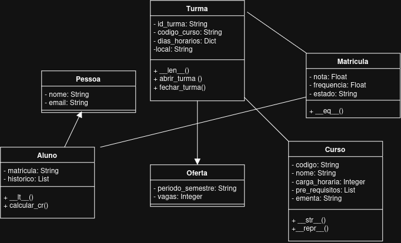

# ES0008 | TEMA 6: GERENCIADOR DE CURSOS E ALUNOS

### Projeto desenvolvido no âmbito da disciplina, focado nos princípios de **Programação Orientada a Objetos (POO)**. O sistema engloba a gestão de alunos, cursos, turmas e matrículas, aplicando validações rigorosas de regras de negócio, persistência de dados em JSON e interface interativa por linha de comando (CLI).

---

## 🚀 Tecnologias Utilizadas
- **Python 3.14+**

- **Pytest** (para testes automatizados)

- **JSON** (para persistência local de dados)

## 📂 Estrutura do Projeto
```
app/
├── models/
│   ├── pessoas.py         # Classes: Pessoa, Aluno
│   ├── academicos.py      # Classes: Curso, Oferta, Turma
│   └── registros.py       # Classe: Matricula
│
├── services/
│   ├── regras_negocio.py  # Pré-requisitos, choques de horário, vagas e aprovação)
│   ├── relatorios.py      # Lógica matemática (taxa de aprovação, notas, Top N)
│   └── dados.py           # Módulo de persistência para salvar/carregar dados
│
├── cli/                   # Agrupa os subcomandos do terminal
│   └── main.py            # Menu interativo de linha de comando (CLI)
│
├── tests/
│   └── test_regras.py     # Testes exigidos com pytest cobrindo os fluxos principais e erros
│
└── settings.json          # Ficheiro de configurações (nota_minima_aprovacao, data_limite_trancamento, etc.)
```

## ⚙️ Como Executar a Aplicação (CLI)

Para iniciar o sistema de menus interativo, certifique-se de que se encontra na **pasta raiz** do repositório e execute o comando:

```bash
python3 -m app.cli.main
```

Através do menu, poderá:

    Registrar novos Alunos.

    Registrar Cursos no catálogo.

    Criar Turmas associadas a um curso, definir vagas, horários e locais.

    Efetuar Matrículas (com validação automática de capacidade máxima e conflitos de horário).

    Visualizar relatórios detalhados de turmas, vagas e alunos inscritos.

Nota: Todas as alterações são guardadas automaticamente no ficheiro dados_academicos.json na raiz do projeto.


## 🧪 Como Executar os Testes Automatizados

A suíte de testes valida todas as regras de negócio e modelos implementados. Para executá-la na máquina do avaliador ou no seu ambiente, basta abrir o terminal na pasta raiz e digitar:

```bash
pytest

```

### Diagrama UML

