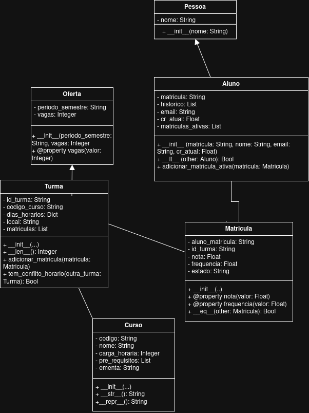

# ES0008 | TEMA 6: GERENCIADOR DE CURSOS E ALUNOS

### Projeto desenvolvido no âmbito da disciplina, focado nos princípios de **Programação Orientada a Objetos (POO)**. O sistema engloba a gestão de alunos, cursos, turmas e matrículas, aplicando validações rigorosas de regras de negócio, persistência de dados em JSON e interface interativa por linha de comando (CLI).

---

## 🚀 Tecnologias Utilizadas
- **Python 3.14+**

- **Pytest** (para testes automatizados)

- **JSON** (para persistência local de dados)

## 📂 Estrutura do Projeto
```
app/
├── models/
│   ├── pessoas.py         # Classes: Pessoa, Aluno
│   ├── academicos.py      # Classes: Curso, Oferta, Turma
│   └── registros.py       # Classe: Matricula
│
├── services/
│   ├── regras_negocio.py  # Pré-requisitos, choques de horário, vagas e aprovação)
│   ├── relatorios.py      # Lógica matemática (taxa de aprovação, notas, Top N)
│   └── dados.py           # Módulo de persistência para salvar/carregar dados
│
├── cli/                   # Agrupa os subcomandos do terminal
│   └── main.py            # Menu interativo de linha de comando (CLI)
│
├── tests/
│   └── test_regras.py     # Testes exigidos com pytest cobrindo os fluxos principais e erros
│
└── settings.json          # Ficheiro de configurações (nota_minima_aprovacao, data_limite_trancamento, etc.)
```

## ⚙️ Como Executar a Aplicação (CLI)

Para iniciar o sistema de menus interativo, certifique-se de que se encontra na **pasta raiz** do repositório e execute o comando:

```bash
python3 -m app.cli.main
```

Através do menu, poderá:

    Registrar novos Alunos.

    Registrar Cursos no catálogo.

    Criar Turmas associadas a um curso, definir vagas, horários e locais.

    Efetuar Matrículas (com validação automática de capacidade máxima e conflitos de horário).

    Visualizar relatórios detalhados de turmas, vagas e alunos inscritos.

Nota: Todas as alterações são guardadas automaticamente no ficheiro dados_academicos.json na raiz do projeto.

Aqui está uma seção completa e atualizada dos **Exemplos de Uso / Funcionalidades** para incluir no seu `README.md`, refletindo todas as opções do menu implementadas no sistema CLI:

---

## 🚀 Exemplos de Uso das Funcionalidades

O sistema é operado através de um menu interativo baseada em linha de comando (CLI) com 8 opções principais e fluxo otimizado com pausas para leitura dos resultados.

### 1. Registrar Aluno

Permite cadastrar novos discentes no sistema informando os dados acadêmicos básicos.

* **Entrada no CLI:** Opção `1`
* **Exemplo de dados:**
* Matrícula: `20261001`
* Nome completo: `Ana Silva`
* E-mail institucional: `ana.silva@ufca.edu.br`
* CR inicial: `8.5`


### 2. Registrar Curso

Cadastra as matrizes curriculares/disciplinas disponíveis na instituição.

* **Entrada no CLI:** Opção `2`
* **Exemplo de dados:**
* Código do curso: `ES0008`
* Nome: `Programação Orientada a Objetos`
* Carga horária: `60`
* Ementa: `Conceitos avançados de POO em Python.`


### 3. Criar Turma

Abre uma turma associada a um curso cadastrado, definindo capacidade e horários.

* **Entrada no CLI:** Opção `3`
* **Exemplo de dados:**
* ID da Turma: `POO-2026.1`
* Seleção do Curso: `ES0008`
* Período/Semestre: `2026.1`
* Capacidade de vagas: `30`
* Local/Sala: `Bloco A - Sala 12`
* Dias e horários: `Seg 10:00`, `Qua 10:00`


### 4. Realizar Matrícula

Efetua a matrícula de um aluno em uma turma com **validação automática** de regras de negócio:

1. *Verificação de Vagas:* Impede matrículas se a turma estiver lotada.
2. *Conflito de Horário:* Valida se o aluno já possui outra matéria no mesmo horário e semestre.
3. *Pré-requisitos:* Checa se o aluno cumpriu as disciplinas obrigatórias do histórico.

* **Entrada no CLI:** Opção `4`

### 5. Listar Turmas e Relatório de Vagas

Exibe um panorama geral de todas as turmas, o status de ocupação das vagas, salas, horários e a listagem detalhada de alunos matriculados com notas e estados individuais.

* **Entrada no CLI:** Opção `5`

### 6. Lançar Notas e Frequência

Permite registrar o desempenho do aluno. O sistema calcula automaticamente o estado acadêmico com base nas regras configuradas (`settings.json`):

* `Aprovado` (Nota $\ge 6.0$ e Frequência $\ge 75\%$)
* `Reprovado por Nota`
* `Reprovado por Frequência`
* **Entrada no CLI:** Opção `6`

### 7. Trancar Matrícula

Permite alterar o estado de uma matrícula ativa para trancada, desde que o vínculo esteja regular.

* **Entrada no CLI:** Opção `7`

### 8. Relatórios Académicos

Módulo avançado de estatísticas e consultas:

1. **Taxa de Aprovação:** Calcula o percentual de aprovação (geral ou filtrado por turma específica).
2. **Distribuição de Notas:** Computa estatísticas descritivas como **Média**, **Mediana** e **Desvio Padrão**.
3. **Top N Alunos por CR:** Gera o ranking dos melhores alunos ordenados pelo Coeficiente de Rendimento.

* **Entrada no CLI:** Opção `8`

---


## 🧪 Como Executar os Testes Automatizados

A suíte de testes valida todas as regras de negócio e modelos implementados. Para executá-la na máquina do avaliador ou no seu ambiente, basta abrir o terminal na pasta raiz e digitar:

```bash
pytest

```

### Diagrama UML

